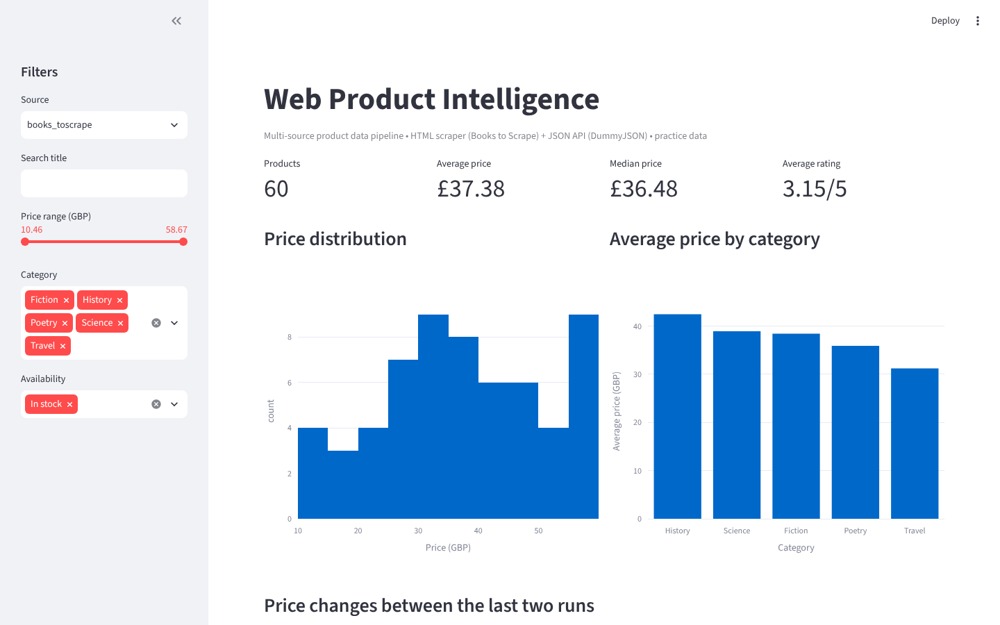
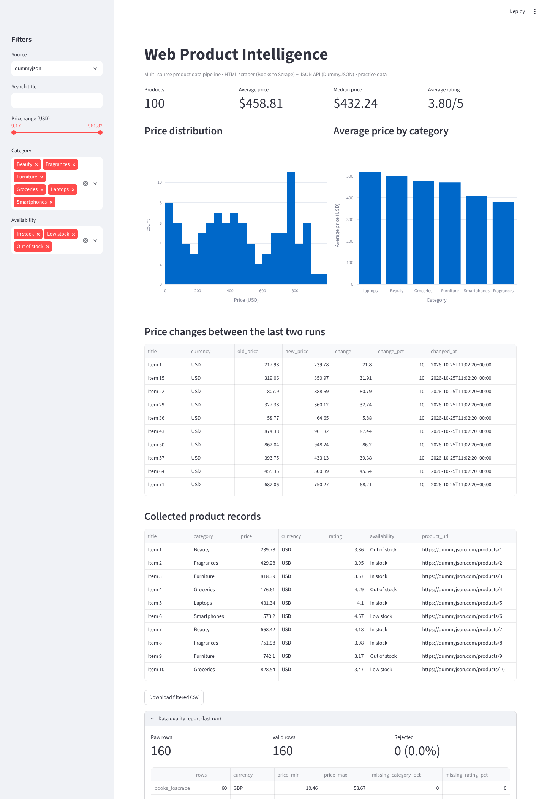

# Web Product Intelligence Pipeline

A multi-source web data pipeline: it **collects** product data from an HTML website and a JSON API, **cleans and validates** it into one schema, **stores** it (CSV + SQLite with a price history), runs **SQL analysis**, writes a **data-quality report**, and presents everything in a **Streamlit dashboard**.

## Screenshots

> Captured on **synthetic sample data** served from local mock servers that mimic the structure of the real sources (the sandbox used to build this had no access to the live sites). Run the pipeline yourself for real results, then replace these images.





## What it demonstrates

| Area | Where |
|---|---|
| HTML scraping (pagination, detail pages) | `src/scraper.py` - Requests + BeautifulSoup, pure parse functions |
| API ingestion (limit/skip paging) | `src/api_source.py` |
| Polite, resilient crawling | `src/http.py` (retries, backoff, User-Agent), `robots.txt` check, delays |
| Cleaning and validation | `src/pipeline.py` - one schema for all sources, rejects bad rows, dedupes per source |
| Storage and price history | `src/storage.py` - latest snapshot + append-only `price_history` table |
| SQL analysis | `sql/*.sql` - window functions, CTEs, aggregations |
| Data quality | `src/quality.py` -> `data/quality_report.json` |
| Automation / Linux | `scripts/run_pipeline.sh` + cron example, GitHub Actions CI |
| Testing | `tests/` - HTML fixtures, API fixtures, SQL files run against a temp database |

Sources (both are public practice/demo targets): [Books to Scrape](https://books.toscrape.com/) (HTML, GBP) and [DummyJSON](https://dummyjson.com/products) (JSON API, USD). Only point the scraper at other sites when you have permission and their terms/robots rules allow automated access.

## Run

```bash
python -m venv .venv && source .venv/bin/activate     # Windows: py -m venv .venv ; .\.venv\Scripts\Activate.ps1
python -m pip install -r requirements.txt

python -m src.pipeline                      # both sources, fast
python -m src.pipeline --details            # books: also fetch category + SKU per product (slower)
python -m src.pipeline --sources dummyjson  # one source only
python -m src.pipeline --max-pages 2 --max-items 50   # quick test run

streamlit run app.py
python -m pytest -q
```

Run it more than once (for example on a schedule) and the dashboard's **price changes** table fills in from `price_history`.

Schedule on Linux/macOS with cron (see `scripts/run_pipeline.sh`):

```cron
0 6 * * * /path/to/web_product_intelligence/scripts/run_pipeline.sh >> /path/to/web_product_intelligence/data/run.log 2>&1
```

## Output schema

`source, title, price, currency, availability, rating, category, sku, product_url, source_url, scraped_at_utc`

Prices from different sources use different currencies, so the dashboard analyses one source at a time instead of mixing them. Books `category` and `sku` are only filled with `--details`.

## Project structure

```text
app.py                  Streamlit dashboard
src/scraper.py          HTML source (Books to Scrape)
src/api_source.py       JSON API source (DummyJSON)
src/http.py             shared HTTP session + retries
src/pipeline.py         orchestration, cleaning, CLI
src/quality.py          data-quality report
src/storage.py          CSV / SQLite / price history / SQL runner
sql/                    analysis queries
scripts/run_pipeline.sh scheduled-run wrapper
tests/                  pytest suite
```

## Limitations

- Practice sources only; no commercial-store data.
- Price changes need at least two runs to appear.
- SQLite and CSV outputs are local files; there is no hosted deployment.
